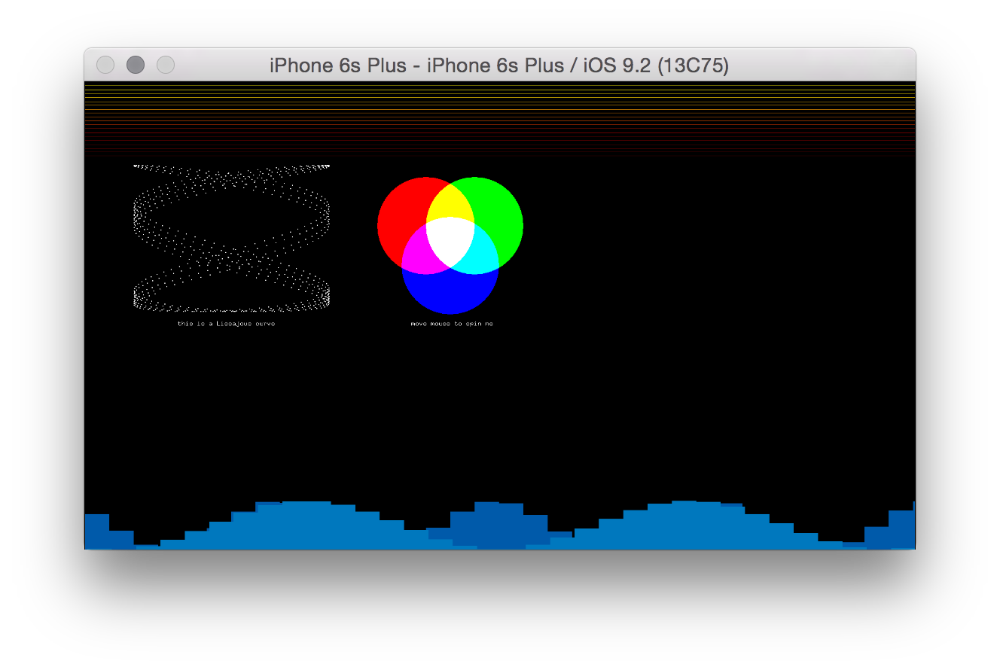
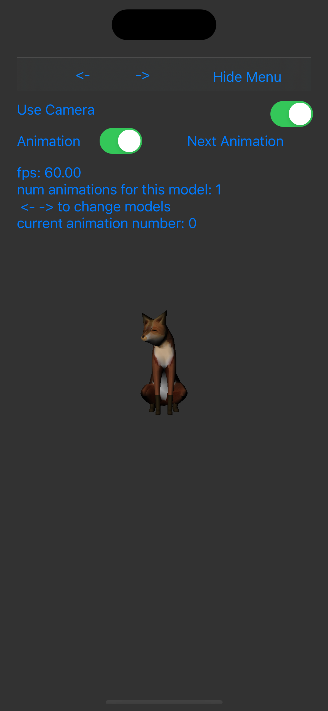

# About <This Section>

--

### Learning Objectives

This section of examples aims to provide understanding around the topic of <insert topic> and some examples of use...

### Table of Contents

* [advancedEventsExample](advancedEventsExample/) - Custom Events in iOS
* [advancedGraphics](advancedGraphics/) - Advanced Graphics (Lissa Jous, etc)
* [assimpExample](assimpExample/) - Loading 3D Models that can animate in a 3D space
* [audioInputExample](audioInputExample/) - Handling incoming audio signal
* [audioOutputExample](audioOutputExample/) - Create sounds for an iOS application

...

### At a Glance

)
([advancedEventsExample](advancedEventsExample/))

([advancedGraphics](advancedGraphics/))

([assimpExample](assimpExample/))

### Privacy and location support

Customize the purpose strings in the [iOS template plist](../../scripts/templates/ios/ofxiOS-Info.plist) to explain why your app uses each protected API, and remove unused keys. Missing required purpose strings can cause App Store validation error ITMS-90683, even for APIs your app does not call directly.

CoreLocation and MapKit support are enabled by default. To disable them, build both the core library and app with `OFXIOS_ENABLE_LOCATION=0`, either through `xcodebuild` or [CoreOF.xcconfig](../../libs/openFrameworksCompiled/project/ios/CoreOF.xcconfig). Rebuild any prebuilt core library. You can then remove `NSLocationWhenInUseUsageDescription` if your app and addons do not otherwise use location APIs.
